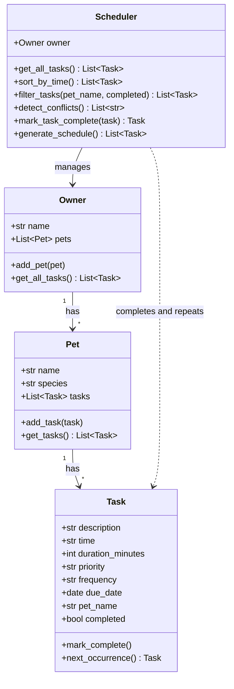

# PawPal+ (Module 2 Project)

PawPal+ is a Streamlit app that helps a busy pet owner plan care tasks (feeding, bathroom breaks, walks, medication, and more) for one or more pets. The logic lives in `pawpal_system.py`, is verified with a CLI demo (`main.py`) and automated tests, and is then connected to the Streamlit UI (`app.py`).

## Scenario

A busy pet owner needs help staying consistent with pet care. They want an assistant that can:

- Track pet care tasks (walks, feeding, meds, enrichment, grooming, etc.)
- Keep tasks organized by time and show what comes next
- Warn about scheduling conflicts and repeat daily or weekly tasks automatically

## Getting Started

### Setup

```bash
python3 -m venv .venv
source .venv/bin/activate  # Windows: .venv\Scripts\activate
pip install -r requirements.txt
```

### Run the app

```bash
python3 -m streamlit run app.py
```

### Run the CLI demo

```bash
python3 main.py
```

### Project structure

| File | Purpose |
|------|---------|
| `pawpal_system.py` | Logic layer: `Task`, `Pet`, `Owner`, and `Scheduler` classes |
| `main.py` | CLI demo that shows sorting, filtering, conflicts, and recurring tasks |
| `app.py` | Streamlit UI connected to the logic layer |
| `tests/test_pawpal.py` | Automated pytest suite |
| `diagrams/uml_draft.mmd`, `diagrams/uml_final.mmd` | Mermaid UML diagrams (initial and final) |
| `reflection.md` | Design, tradeoff, and AI collaboration reflection |

## 🖥️ Sample Output

Output from running `python3 main.py`:

```
1. Unsorted (order added)
------------------------------------------------------------
[ ] 2026-10-27 18:00  Pika   Dinner     (daily)
[ ] 2026-10-27 07:30  Pika   Breakfast  (daily)
[ ] 2026-10-27 12:30  Pika   Lunch      (once)
[ ] 2026-10-27 07:00  Pika   Bathroom   (once)
[ ] 2026-10-27 19:00  Mochi  Play time  (once)
[ ] 2026-10-27 07:30  Mochi  Feeding    (once)

2. Sorted by time
------------------------------------------------------------
[ ] 2026-10-27 07:00  Pika   Bathroom   (once)
[ ] 2026-10-27 07:30  Pika   Breakfast  (daily)
[ ] 2026-10-27 07:30  Mochi  Feeding    (once)
[ ] 2026-10-27 12:30  Pika   Lunch      (once)
[ ] 2026-10-27 18:00  Pika   Dinner     (daily)
[ ] 2026-10-27 19:00  Mochi  Play time  (once)

3. Only Pika's tasks
------------------------------------------------------------
[ ] 2026-10-27 07:00  Pika   Bathroom   (once)
[ ] 2026-10-27 07:30  Pika   Breakfast  (daily)
[ ] 2026-10-27 12:30  Pika   Lunch      (once)
[ ] 2026-10-27 18:00  Pika   Dinner     (daily)

4. Conflict check
------------------------------------------------------------
Warning: Mochi's Feeding and Pika's Breakfast are both at 07:30 on 2026-10-27

5. Completed Pika's Breakfast. Next one created for 2026-10-28

6. Done tasks
------------------------------------------------------------
[x] 2026-10-27 07:30  Pika   Breakfast  (daily)

7. Not done tasks (sorted)
------------------------------------------------------------
[ ] 2026-10-27 07:00  Pika   Bathroom   (once)
[ ] 2026-10-27 07:30  Mochi  Feeding    (once)
[ ] 2026-10-27 12:30  Pika   Lunch      (once)
[ ] 2026-10-27 18:00  Pika   Dinner     (daily)
[ ] 2026-10-27 19:00  Mochi  Play time  (once)
[ ] 2026-10-28 07:30  Pika   Breakfast  (daily)
```

## ✨ Features

- **Owner, pets, and tasks:** one owner can have many pets, and each pet has its own tasks (time, duration, priority, repeat).
- **Sorting by time:** the schedule is always shown by date, then time (`Scheduler.sort_by_time()`).
- **Filtering:** show tasks for one pet and/or only done or not-done tasks (`Scheduler.filter_tasks()`).
- **Conflict warnings:** a warning appears when two not-done tasks share the same date and time (`Scheduler.detect_conflicts()`). It only checks exact matches, not overlapping durations.
- **Recurring tasks:** completing a daily or weekly task automatically creates the next one (`Task.next_occurrence()`, `Scheduler.mark_task_complete()`).
- **Streamlit UI:** add pets and tasks, view the sorted schedule, see warnings, filter, and mark tasks complete.
- **Automated tests:** 11 pytest tests cover sorting, recurrence, conflicts, filtering, and edge cases.

## 📐 Smarter Scheduling

| Feature | Method(s) | Notes |
|---------|-----------|-------|
| Task sorting | `Scheduler.sort_by_time()` | Sorts by date, then "HH:MM" time. Used by `generate_schedule()`. |
| Filtering | `Scheduler.filter_tasks(pet_name, completed)` | Keeps one pet's tasks and/or only done or not-done tasks. Results stay in time order. |
| Conflict handling | `Scheduler.detect_conflicts()` | Returns warning messages (does not crash) when two not-done tasks share the same date and time. |
| Recurring tasks | `Task.next_occurrence()`, `Scheduler.mark_task_complete()` | Completing a daily or weekly task creates the next one (+1 day or +7 days) using `timedelta`. |

## 🧪 Testing PawPal+

Run the full test suite:

```bash
python3 -m pytest
```

**What the tests cover:**

- **Task basics:** `mark_complete()` changes status, and adding a task increases a pet's task count.
- **Sorting:** tasks added out of order come back in chronological order.
- **Recurrence:** completing a daily task creates one for the next day, a weekly task creates one 7 days later, and a "once" task creates nothing.
- **Conflict detection:** same-time tasks are flagged, different times are not, and completed tasks are ignored.
- **Edge cases and filtering:** a pet with no tasks, and filtering by pet name and completion status.

Sample test output:

```
================================================================== test session starts ===================================================================
platform darwin -- Python 3.13.15, pytest-9.1.1, pluggy-1.7.0
rootdir: /Users/ena/Projects VScode/CEN5035-001/PawPal+/ai110-module2show-pawpal-starter
plugins: anyio-4.15.1
collected 11 items

tests/test_pawpal.py ...........                                                                                                                   [100%]

=================================================================== 11 passed in 0.04s ===================================================================
```

**Confidence Level:** ★★★★☆ (4/5). All 11 tests pass and cover the main behaviors. Conflict detection only checks for exact matching times, not overlapping durations, so I am not at 5 stars.

## 🏗️ System Design (UML)

Final class diagram (source: `diagrams/uml_final.mmd`; the initial draft is `diagrams/uml_draft.mmd`):



## 📸 Demo Walkthrough

Start the app with `python3 -m streamlit run app.py`.

1. **Enter the owner and add a pet.** Type the owner's name, then add a pet (for example Pika, a dog) with **Add pet**.
2. **Add tasks.** Choose the pet, then enter a title, time, duration, priority, and how often it repeats (once, daily, or weekly), and click **Add task**.
3. **View today's schedule.** Tasks from every owner appear together in one table sorted by date and time, with an Owner column, a priority icon, and a done checkbox.
4. **Check for conflicts.** If two not-done tasks are at the same time, a yellow warning names both tasks. Otherwise a green message says there are no conflicts.
5. **Filter the schedule.** Use **Show owner**, **Show pet**, and **Show status** to narrow the table to one person, one pet, or only done or not-done tasks.
6. **Mark a task complete.** Pick a task and click **Mark complete**. If it repeats daily or weekly, a new task is created for the next day or week.

**Key Scheduler behaviors shown:** sorting by time, conflict warnings, filtering by pet and status, and daily or weekly recurrence.

**Example CLI output from `main.py` (excerpt):**

```
2. Sorted by time
------------------------------------------------------------
[ ] 2026-10-27 07:00  Pika   Bathroom   (once)
[ ] 2026-10-27 07:30  Pika   Breakfast  (daily)
[ ] 2026-10-27 07:30  Mochi  Feeding    (once)
[ ] 2026-10-27 12:30  Pika   Lunch      (once)
[ ] 2026-10-27 18:00  Pika   Dinner     (daily)
[ ] 2026-10-27 19:00  Mochi  Play time  (once)

4. Conflict check
------------------------------------------------------------
Warning: Mochi's Feeding and Pika's Breakfast are both at 07:30 on 2026-10-27

5. Completed Pika's Breakfast. Next one created for 2026-10-28
```

**Screenshot or video** *(optional)*: add one here if you like.
<video src="https://github.com/YourAznGurl/ai110-module2show-pawpal-starter/blob/main/PawPal%2B.mp4">
</video>
